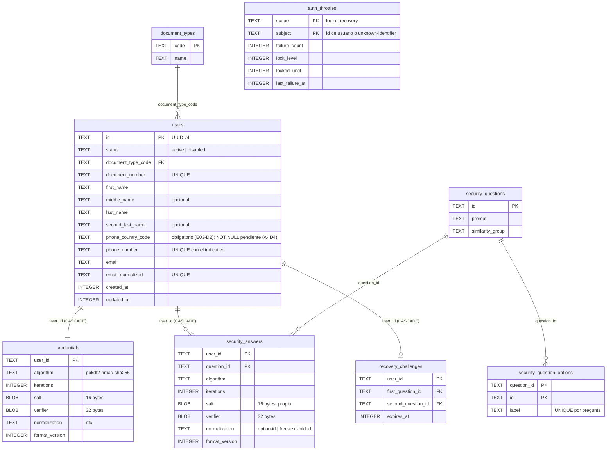

# Arquitectura de identidad, credenciales y persistencia — GFP

Diseño adoptado en la Etapa 02 para E02-D1 a E02-D5 y la recuperación por preguntas
de seguridad (decisiones en `decisiones.md`). Fuentes: HU1, HU2 y HU3 del documento
de historias de usuario y la WU del 2026-10-25. Implementación en `app/src/` y
pruebas en `app/__tests__/`. No implementa las pantallas ni los flujos de HU1, HU2 ni HU3.

## 1. Modelo multiusuario (E02-D4)

**Alternativa elegida: una única base de datos SQLCipher compartida, con aislamiento
lógico estricto por usuario.**

| Criterio | Base compartida con aislamiento | Una base por cuenta |
|---|---|---|
| Inicio de sesión (HU2) por correo, documento o celular | Búsqueda directa en `users` | Necesita además un índice global de cuentas fuera de las bases por cuenta |
| Usuario ya registrado (HU1) | Restricciones `UNIQUE` en una sola base | Comprobación entre bases, sin integridad transaccional |
| Migraciones | Un único migrador y una única versión de esquema | Migrar N archivos; un fallo parcial deja versiones mezcladas |
| Clave SQLCipher | Una clave en Android Keystore | N claves que custodiar y rotar |
| Categorías del sistema (HU8) | Compartidas en una tabla | Duplicadas en cada base |
| Riesgo principal | Un error de consulta podría mezclar datos de usuarios | Complejidad operativa y de recuperación |

El riesgo principal se mitiga con la arquitectura de acceso:

- Cada cuenta tiene un identificador UUID v4 independiente, generado con `RNGetRandomValues`.
- Todo dato privado tiene una columna `user_id` con clave foránea a `users (id) ON DELETE CASCADE`, o pertenece a una tabla que la tiene.
- Las operaciones sobre datos privados no reciben un `userId`: reciben la sesión activa (`UserSession`) y `OwnedRepository.ownerOf()` obtiene el propietario de `SessionManager.requireOwner()`. La sesión se compara por identidad de objeto, así que una copia con otro `userId`, una sesión anterior o una sesión cerrada se rechazan con `SessionError`.
- Cerrar sesión (`SessionManager.end()`) invalida la sesión. Cambiar de usuario crea una sesión nueva e invalida la anterior.
- Las búsquedas anteriores a la autenticación (inicio de sesión, recuperación) usan `IdentityRepository` y nunca devuelven datos financieros.

**El cifrado no aísla usuarios.** SQLCipher protege el archivo en reposo frente a
quien lo extrae del dispositivo; la clave es del dispositivo, no de la cuenta. El
aislamiento entre cuentas locales es lógico y depende de las reglas anteriores.

Comportamiento de las cuentas:

| Situación | Comportamiento |
|---|---|
| Cambiar de usuario | Se cierra la sesión actual y se inicia otra con la nueva autenticación |
| Recuperar una cuenta | Solo cambia la credencial de esa cuenta; reinicia sus contadores de intentos y su reto |
| Bloqueo temporal | Por intentos fallidos (`auth_throttles`); no cambia el estado de la cuenta |
| Cuenta inhabilitada | `users.status = 'disabled'` excluye la cuenta del inicio de sesión y de la recuperación. Ninguna HU lo activa en el MVP |
| Eliminar una cuenta | Ninguna HU lo solicita. Si se incorpora, `DELETE FROM users` elimina en cascada su credencial, sus respuestas, su reto y sus datos privados en una transacción |
| Varios dispositivos | Fuera de alcance: no hay sincronización ni autenticación remota |

## 2. Modelo de datos (E02-D5)

Esquema `v1` (`identity-and-security-schema`) y catálogos `v2`
(`proposed-identity-catalogs`) en `app/src/infrastructure/database/migrations.ts`.
Todas las tablas son `STRICT`; las claves foráneas se activan con
`PRAGMA foreign_keys = ON` en cada apertura.

Además, `schema_migrations (version, name, checksum, applied_at)` registra cada
migración aplicada y `PRAGMA user_version` refleja la versión.

| Aspecto | Decisión |
|---|---|
| Tipos | Identificadores y textos `TEXT`; fechas `INTEGER` en milisegundos UTC; sal y verificador `BLOB` con longitud comprobada por `CHECK` |
| Unicidad | `document_number`, `email_normalized` y (`phone_country_code`, `phone_number`). El celular es obligatorio (E03-D2). Aprobado e implementación pendiente: espacio de identificadores inequívoco entre documento y celular (A-ID1), celular canónico E.164 único (A-ID2), documento normalizado único (A-ID3) y columnas `NOT NULL` en la migración 1, que no se ha distribuido (A-ID4); ver `decisiones-etapa-03.md`. HU2 permite iniciar sesión con cualquiera de los tres, así que cada uno debe identificar una sola cuenta (E03-D3) |
| Integridad | Claves foráneas con `ON DELETE CASCADE` desde `users`; `CHECK` sobre algoritmo, iteraciones, longitudes y estados |
| Transacciones | Cada migración se aplica en una transacción con su registro en `schema_migrations`; la creación de cuenta (usuario, credencial y 5 respuestas) y el cambio de contraseña por recuperación son atómicos |
| Versionado | Migraciones numeradas, consecutivas e inmutables una vez entregadas; la suma SHA-256 de cada migración aplicada se comprueba en cada apertura |
| Actualización sin pérdida | Solo se aplican las migraciones pendientes; si una falla se revierte entera. Una base con una versión posterior a la de la app (`newer_schema`) o con una migración modificada (`checksum_mismatch`) no se toca y se informa el error |
| Entidades financieras | No se anticipan. HU4 y HU8 añadirán sus tablas con `user_id` en migraciones posteriores |

Los catálogos de la versión 2 (`document_types` y preguntas con opciones) son
propuestas pendientes de aprobación (E03-D4 y E03-D5). Mientras no haya una entrega de
la Etapa 03, pueden ajustarse editando esa migración; después de entregarse, cualquier
cambio requiere una migración nueva.

## 3. Credenciales (E02-D1, E02-D2)

| Elemento | Valor |
|---|---|
| Algoritmo | PBKDF2-HMAC-SHA256 |
| Sal | 16 bytes aleatorios por secreto (`RNGetRandomValues`), almacenada junto al verificador; no es secreta |
| Clave derivada | 32 bytes |
| Iteraciones | **600 000, provisional** (`PROVISIONAL_PBKDF2_ITERATIONS`), versionado en cada registro. Pendiente de la calibración P-D1 |
| Comparación | Tiempo constante (`constantTimeEqual`) |
| Formato | Columnas `algorithm`, `iterations`, `salt`, `verifier`, `normalization` y `format_version` (1). `needsRehash()` detecta registros con parámetros antiguos para regenerarlos tras un inicio de sesión correcto |
| Implementación | Módulo nativo `GfpCrypto` (TurboModule de la app): `Pbkdf2HmacSha256.java` sobre `javax.crypto.Mac("HmacSHA256")` de la plataforma, con su propio grupo de hilos |

**Por qué no JavaScript:** `@noble/hashes` en Hermes tardó 70,9 s (mediana) en
600 000 iteraciones en el emulador (`evidencias/ETAPA-02/V4/p3-benchmark.txt`), unas
8 500 iteraciones por segundo. Un segundo por derivación con ese rendimiento no es un
parámetro defendible. La implementación nativa recibe los bytes UTF-8 exactos, no un
`String` de Java, para que la normalización dependa solo de la política de la app.

Normalización (E02-D2):

- Contraseñas: NFC antes de derivar, al registrar, autenticar y recuperar. No se convierten a minúsculas ni se eliminan espacios internos.
- Espacios externos: una contraseña nueva con espacios al inicio o al final se rechaza (`outer_whitespace`); al verificar no se recorta nada, para no cambiar la credencial en silencio.
- Entradas inválidas: se rechazan los caracteres de control y las unidades sustitutas (surrogates) aisladas.
- Reglas de HU1 y HU3: mínimo 8 caracteres, al menos 1 letra (`\p{L}`), 1 número (`\p{Nd}`) y 1 símbolo (cualquier carácter que no sea letra, marca, dígito ni espacio). Máximo 128 puntos de código tras NFC (E03-D10).
- Compatibilidad: no existen credenciales almacenadas antes de esta política, así que no hace falta migrarlas. Cada verificador registra `normalization = 'nfc'`; un cambio futuro de política requiere un valor nuevo y la regeneración tras un inicio de sesión correcto, nunca una reinterpretación silenciosa.
- Si `String.prototype.normalize('NFC')` no funciona en el motor de JavaScript, la operación falla de forma segura (`UnicodeNormalizationUnavailableError`). Su disponibilidad en Hermes se comprueba en P-D2.

## 4. Recuperación con preguntas de seguridad

| Regla | Origen | Implementación |
|---|---|---|
| Registro con 5 preguntas del catálogo, sin repetir ni elegir preguntas similares | HU1 | `validateRegistrationAnswers()`; dos preguntas son similares si comparten `similarity_group` (E03-D6) |
| Respuestas seleccionables entre opciones del catálogo | WU 2026-10-25 (C-03) | El verificador se calcula sobre el identificador estable de la opción (`option-id`), así que tildes, mayúsculas o espacios no pueden causar errores |
| Respuestas no almacenadas en texto claro, con sal propia | HU1, WU | Un verificador PBKDF2 independiente por respuesta, con los mismos parámetros que la contraseña |
| Identificador primero; error «Identificador incorrecto» | HU3 | `AccountRecoveryService.start()` devuelve `invalid_identifier` |
| Responder 2 de las 5 preguntas, elegidas al azar | HU3 | Se eligen con `RNGetRandomValues` y se guardan en `recovery_challenges` durante 15 minutos; repetir «Comenzar recuperación» devuelve las mismas preguntas mientras el reto siga vigente, para que no se puedan buscar preguntas más fáciles (E05-D2) |
| Las 2 respuestas deben ser correctas | HU3 | Se verifican siempre ambas, sin salida anticipada; el resultado es único («Datos ingresados incorrectos») y no indica cuál falló |
| Intentos limitados con esperas progresivas | WU | 3 fallos bloquean la recuperación de la cuenta durante 15 minutos; cada bloqueo siguiente dobla la espera (30, 60, 120… minutos) hasta 24 horas (E05-D1). Los identificadores inexistentes repetidos bloquean el inicio de la recuperación en el dispositivo con la misma regla |
| No cambiar la contraseña sin completar la verificación | HU3, WU | La nueva contraseña cumple la política, coincide con la confirmación y solo se guarda tras verificar ambas respuestas, en una transacción que también elimina el reto y reinicia los contadores |
| Retroceso del reloj | Riesgo propio | Si la hora del dispositivo retrocede, el bloqueo vigente se mantiene |
| Intentos simultáneos | Revisión consolidada | `start()` y `complete()` se ejecutan en serie por base de datos, también entre instancias del servicio, para que cada intento lea el contador del anterior. El inicio de sesión (HU2) debe aplicar la misma regla |

Limitaciones que se aceptan expresamente:

- Las opciones de respuesta tienen entropía limitada: con 7 a 11 opciones por pregunta, dos respuestas admiten como mucho 121 combinaciones. Las preguntas de seguridad son un mecanismo de recuperación de menor garantía que un canal externo verificado (correo o SMS), que está fuera del alcance.
- La protección real frente a la adivinación es la limitación de intentos. Quien obtenga el archivo de la base y su clave podría probar todas las combinaciones fuera de línea; PBKDF2 solo lo encarece.
- El mensaje «Identificador incorrecto», exigido por HU3, permite saber si un identificador está registrado. Se mitiga con la limitación de intentos sobre identificadores inexistentes.
- El inicio de sesión de HU2 (3 fallos y 15 minutos de bloqueo) usa la política `LOGIN_THROTTLE_POLICY`. El alcance del bloqueo (por cuenta o por dispositivo) es E04-D1; la tabla `auth_throttles` admite ambos.

## 5. Clave de la base de datos (E02-D3)

| Aspecto | Estrategia |
|---|---|
| Generación | 32 bytes (256 bits) de `RNGetRandomValues`, sin respaldo con `Math.random`. La regla ESLint E02-RNG lo impone en `src/` |
| Custodia | `react-native-keychain`, servicio `co.gfpsas.gestionfinanciera.database-key.v1`, almacenamiento `AES_GCM_NO_AUTH`: la clave queda cifrada por una clave AES de Android Keystore. Sin biometría. La protección respaldada por hardware no está demostrada: el emulador declaró `SECURE_SOFTWARE` |
| Apertura | Clave en formato bruto (`x'…'`); se comprueba `PRAGMA cipher_version`, de modo que sin SQLCipher la app falla en vez de crear una base en claro; después se lee `sqlite_master` para detectar una clave rechazada; se activan las claves foráneas y se migra |
| Primera ejecución | Sin clave y sin base: se genera la clave, se guarda, se relee para confirmarla y se crea la base |
| Clave perdida | Sin clave y con base (`key_lost`) o clave rechazada (`key_rejected`): la apertura falla y **no se borra ni se sustituye la base**. Recuperar los datos no es posible; reiniciar la base exigirá una acción explícita del usuario, que se diseñará en la etapa que la necesite |
| Desinstalación y reinstalación | Android elimina los datos de la app y las claves de Keystore de esa app: la reinstalación empieza de cero (primera ejecución). Comprobación pendiente en un entorno aislado (P-D3) |
| Copias y restauración | `android:allowBackup="false"` y `android:dataExtractionRules` excluyen todos los dominios de la copia en la nube y de la transferencia entre dispositivos, porque la clave de Keystore no se transfiere y una base restaurada sin su clave sería ilegible |
| Eliminación de cuenta | No cambia la clave: la clave es del dispositivo y la base contiene otras cuentas |
| Rotación | No se rota periódicamente en el MVP. Si hiciera falta (sospecha de exposición), el procedimiento es generar una clave nueva, guardarla como pendiente, ejecutar `PRAGMA rekey` y promoverla tras comprobar la apertura |
| Exposición | La clave no se registra ni se muestra: regla ESLint `no-console` en `src/`; los errores solo incluyen motivos (`key_lost`, `key_rejected`…). No se guarda en preferencias, código ni configuración |

## 6. Riesgos residuales

| Riesgo | Tratamiento |
|---|---|
| Iteraciones de PBKDF2 sin medir en el dispositivo mínimo | Valor provisional versionado; prueba P-D1 y regeneración con `needsRehash()` si cambia |
| Comportamiento de Hermes con `normalize` y las expresiones `\p{…}` | Comprobación al ejecutar y prueba P-D2 |
| Keystore sin respaldo por hardware demostrado | No se afirma; se registra el nivel declarado |
| Datos en memoria de JavaScript (contraseña como `string`) | Los arreglos de bytes se borran tras usarse; los `string` de JavaScript no se pueden borrar |
| Errores de consulta que mezclen usuarios | API de repositorios basada en la sesión, pruebas de aislamiento y revisión obligatoria de cada repositorio nuevo |
| Reloj del dispositivo manipulado hacia adelante | Puede acortar un bloqueo; es una limitación de una app sin servidor |
| Reinstalación y pérdida de la clave sin probar en un dispositivo | Prueba P-D3 en un AVD aislado |

Otras reservas abiertas de la Etapa 02 que no dependen de este diseño: el permiso
`INTERNET` se conserva hasta la prueba P-D7 (E02-D7), y los umbrales de calidad del OCR
son propuestas sin aprobar (E02-D8, `plan-evaluacion-ocr.md`).
